# 🌡️ The Temperature Box

**A closed-loop (feedback) room-temperature controller** built as a group project (Group D) for **EEE 305: Control Systems**, BRAC University, Fall 2018. Supervised by Dr. A. K. M. Abdul Malek Azad.

The design follows the *Temperature Box* experiment described by O'Brien & Watkins (IEEE CDC, 1999): an LM35 sensor measures the temperature, an op-amp stage scales it to a convenient voltage range, a pair of comparators checks it against a **high** and a **low** threshold, and a D-flip-flop based logic block drives a BJT + relay that switches the heat source (a bulb in our build) on or off.

<p align="center">
  <a href="video/group-d-demo.mp4">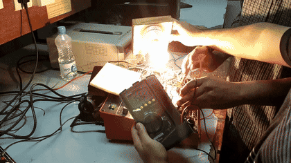</a>
  <br>
  <em>The prototype being tested on the lab bench — <a href="video/group-d-demo.mp4">▶ watch the full demo video</a> (preview clip above, click to open).</em>
</p>

---

## Contents

- [System overview](#system-overview)
- [Hardware](#hardware)
- [Design & calculations](#design--calculations)
- [Results](#results)
- [Demo video](#demo-video)
- [Repository layout](#repository-layout)
- [Reproducing the figures](#reproducing-the-figures)
- [Team](#team)
- [References](#references)

## System overview

Components: LM35 sensor, two op-amp stages (inverting amplifier + scale-and-shift), two comparators, two NAND gates, one D flip-flop, one NPN BJT, one relay, and a bulb as the actuator.

Original block diagram (from the reference paper):

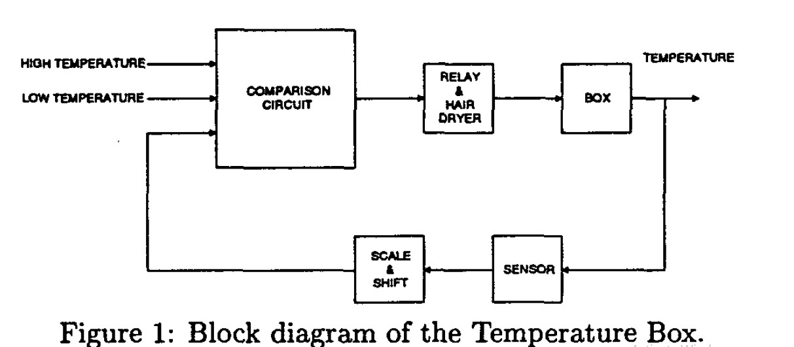

Signal flow of our implementation:

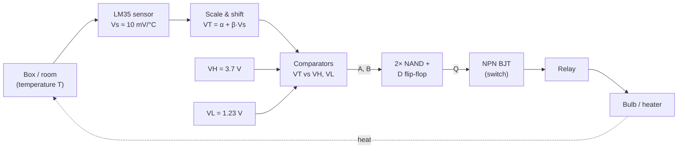

Control behaviour — an on/off controller with **hysteresis** (dead band between VL and VH):

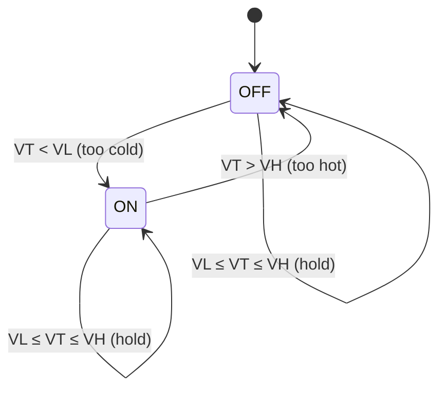

## Hardware

| Stage | Schematic | Notes |
|---|---|---|
| Sensor + inverting amplifier | 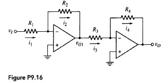 | Two cascaded inverting op-amp stages (R1–R4); shifts the signal into the range needed by the relay circuit. |
| Scale & shift | 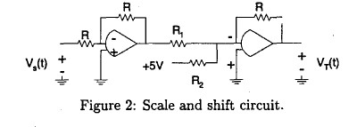 | Maps sensor voltage `Vs` to `VT = α + β·Vs`. |
| Comparison circuit | 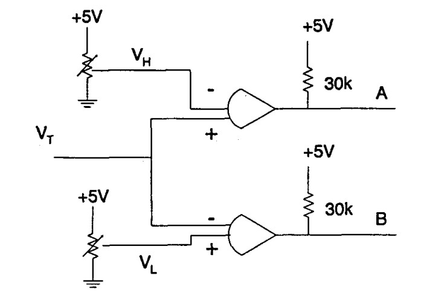 | Two comparators with 30 kΩ pull-ups; potentiometers set `VH` and `VL`. |
| Sequential logic | 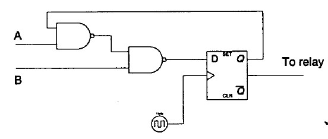 | `D = ¬(¬(A·Q)·B)` — two NAND gates + D flip-flop clocked at a fixed rate. |
| Driver & actuator | 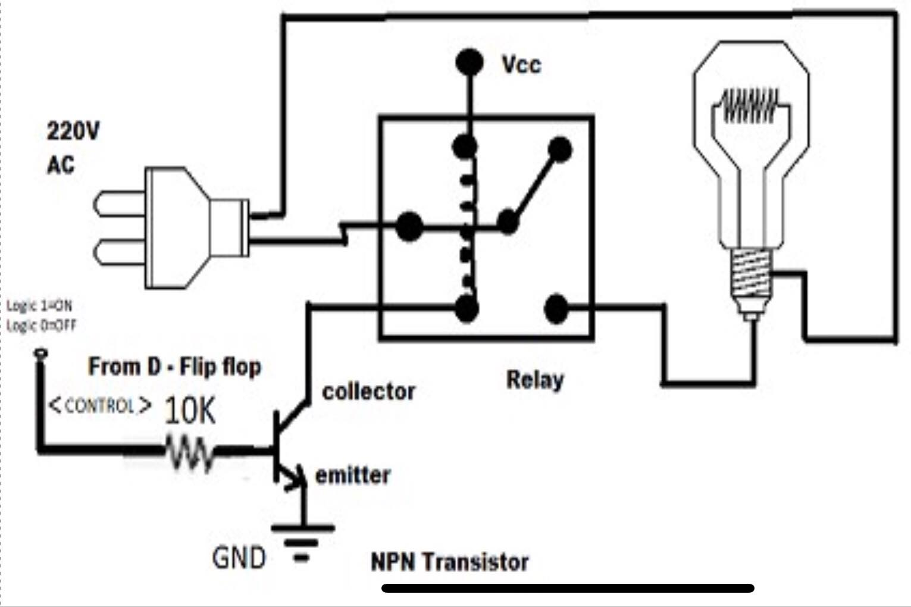 | Flip-flop output → 10 kΩ → NPN base; relay switches the 220 V AC bulb. |

## Design & calculations

### 1. Sensor calibration (LM35)

| °C | °F | Vs (V) |
|---|---|---|
| 24 | 75.2 | 0.27 |
| 25 | 77.0 | 0.28 |
| 26 | 78.8 | 0.29 |
| 27 | 80.6 | 0.30 |
| 28 | 82.4 | 0.31 |
| 29 | 84.2 | 0.32 |
| 30 | 86.0 | 0.33 |
| 31 | 87.8 | 0.34 |
| 32 | 89.6 | 0.35 |
| 33 | 91.4 | 0.36 |
| 34 | 93.2 | 0.37 |
| 35 | 95.0 | 0.38 |

The team's MATLAB fit of the measured readings was `Vs = −0.1369 + 0.005407·T(°F)` (see [original plot](results/original-matlab-fit.png)).

### 2. Scale & shift

The sensor range 75.2 °F → 95 °F (0.27 V → 0.38 V) is mapped to 1.5 V → 3.5 V:

```
VT = α + β·Vs      β = (3.5 − 1.5)/(0.38 − 0.27) ≈ 18.18,   α ≈ −3.40
α = −5·R/R2,   β = R/R1     with R = 100 kΩ  →  R1 = 5.5 kΩ,  R2 = 147.05 kΩ
```

### 3. Comparator thresholds

`VH = 3.7 V`, `VL = 1.23 V`, set with potentiometers. Back-calculating through the scale-and-shift relation and the calibration fit above gives a dead band of roughly **72.5 °F – 97 °F** (derived estimate, not a measured value).

### 4. Logic

Truth table of the flip-flop logic block (`Rk` = present relay state, `Rk+1` = next state), as given in the project presentation:

| A | B | Rk+1 | Meaning |
|---|---|---|---|
| 1 | 0 | 1 | Relay **ON** |
| 0 | 1 | 0 | Relay **OFF** |
| 1 | 1 | Rk | No change (inside the band) |
| 0 | 0 | — | Not reachable (don't care) |

> **Note:** the presentation uses two different A/B encodings (the comparator slide lists the in-band case as `A=B=0`, the logic slide as `A=B=1`). The table above is the one consistent with the NAND/D-flip-flop equation `D = ¬(¬(A·Q)·B)`. The exact comparator polarity depends on how the comparator outputs are wired.

## Results

**Sensor calibration** — the LM35 output is linear over the tested range (re-fit of the table above):

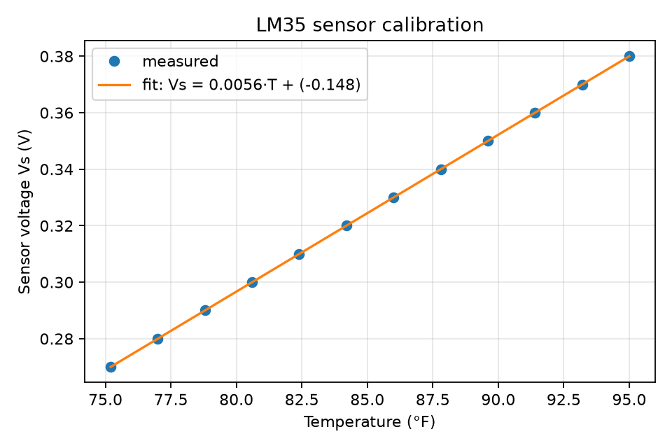

**Scale-and-shift transfer** with the comparator thresholds:

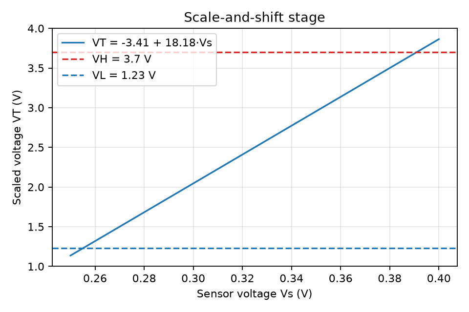

**Hysteresis behaviour** — illustrative simulation of the two-threshold controller; the relay state changes only when `VT` crosses `VL` or `VH` and holds in between:

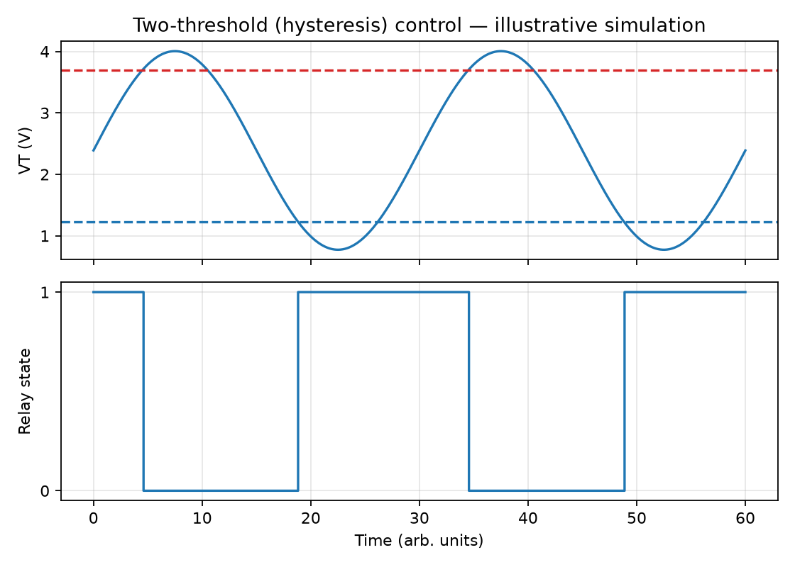

> The hardware prototype worked as designed in the live demonstration (see the video). No quantitative step-response data were recorded, so the hysteresis figure is a simulation of the logic, not a measurement.

## Demo video

[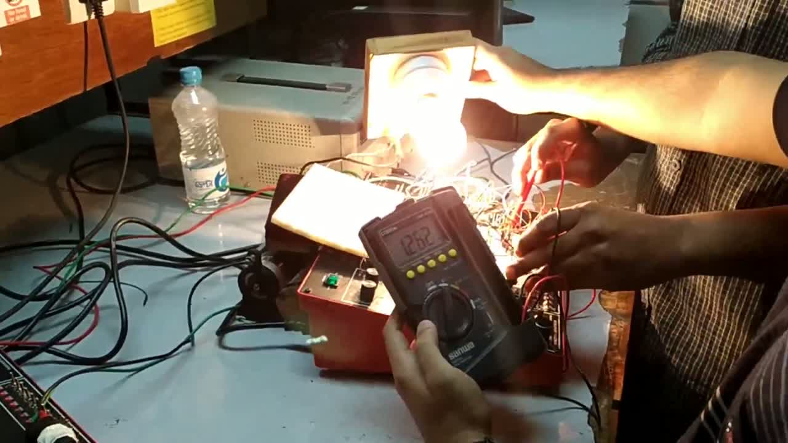](video/group-d-demo.mp4)

[▶ `video/group-d-demo.mp4`](video/group-d-demo.mp4) (≈ 1 min 31 s, 1080p) shows the team building and testing the circuit and the final working demonstration. On GitHub, clicking the link opens the file page, where the video plays in the browser.

## Repository layout

```
├── README.md
├── docs/
│   ├── group-d-presentation.pptx            # Project presentation slides
│   ├── reference-paper-obrien-watkins-1999.pdf   # "The Temperature Box" IEEE CDC paper
│   └── ldr-motion-security-proposal.pdf     # Separate Group D proposal (LDR/motion security)
├── images/
│   ├── schematics/                          # Block diagram & circuit schematics
│   └── demo/                                # Preview GIF + frame from the demo video
├── results/                                 # Result figures
├── scripts/generate_figures.py              # Regenerates results/*.png
└── video/group-d-demo.mp4                   # Demonstration video
```

> `docs/ldr-motion-security-proposal.pdf` is a different course proposal by the same group (a 14-stage ripple-counter based LDR/motion security alarm). It is kept for completeness and is not part of the Temperature Box design.

## Reproducing the figures

```bash
pip install numpy matplotlib
python scripts/generate_figures.py
```

## Team

Group D, EEE 305 (Fall 2018), BRAC University:


Nazifa Tabassum Zaima · Nusrat Islam · Tanjil Ahmed · Palash Chandra Ghosh · Md. Sajid Akbar · Rayed Md Muhaymin Hasan · Md Rezuwan Hassan · Mehrab Azam Khan

Instructor: [Dr. A. K. M. Abdul Malek Azad]([images/schematics/block-diagram.jpg](https://engineering.bracu.ac.bd/profile/akm-abdul-malek-azad-phd))


## References

1. R. T. O'Brien Jr. and J. M. Watkins, "The Temperature Box: An Introductory Control Systems Project," *Proc. 38th IEEE Conference on Decision and Control*, Phoenix, AZ, Dec. 1999. ([PDF](docs/reference-paper-obrien-watkins-1999.pdf))
